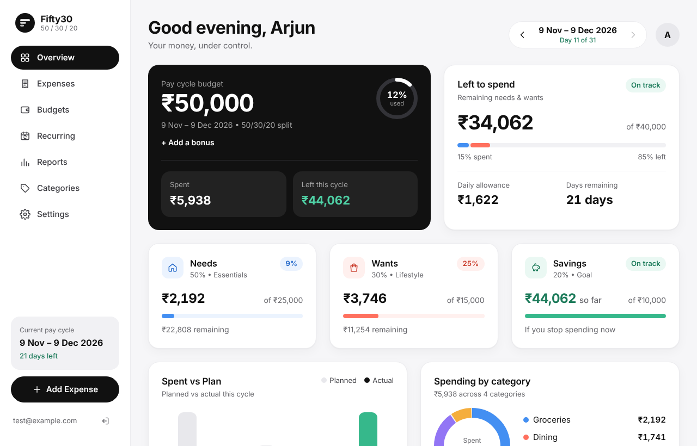
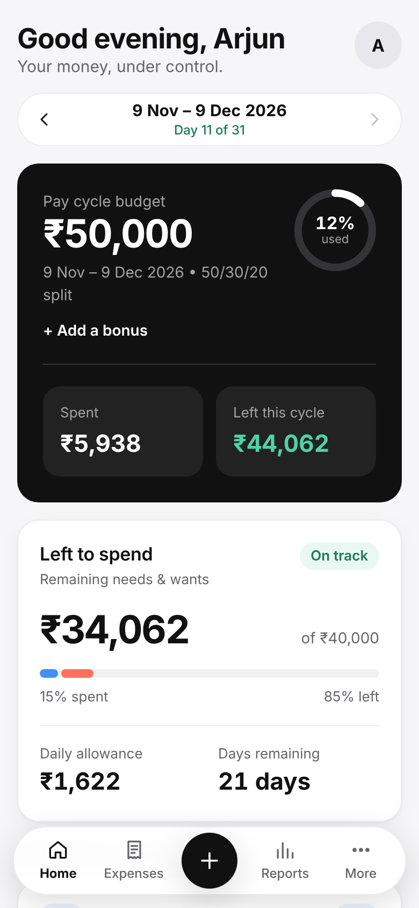
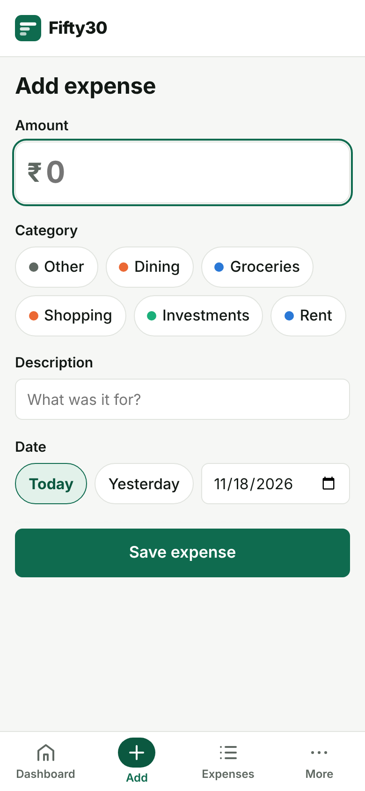
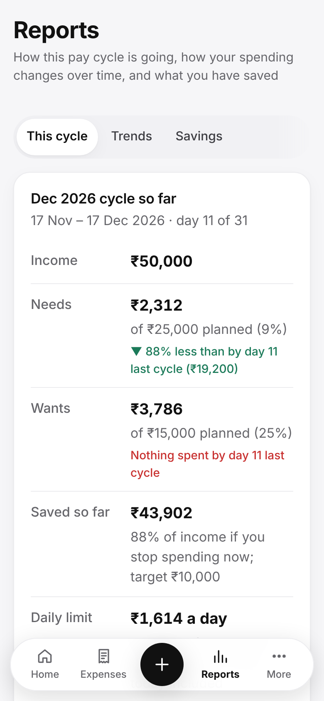
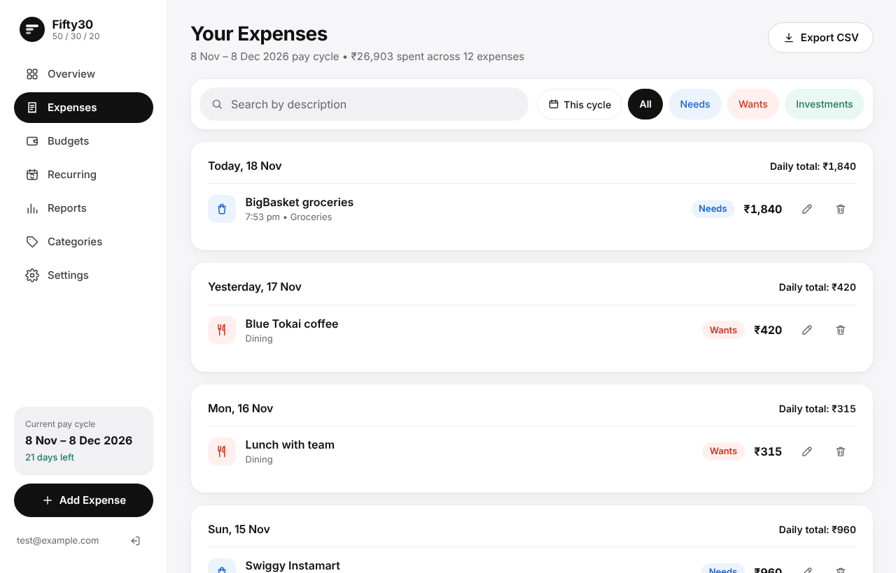
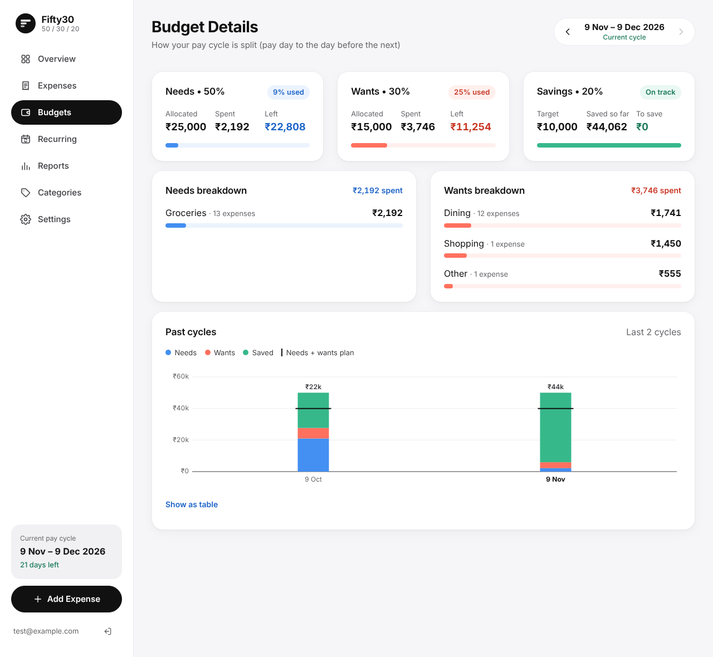
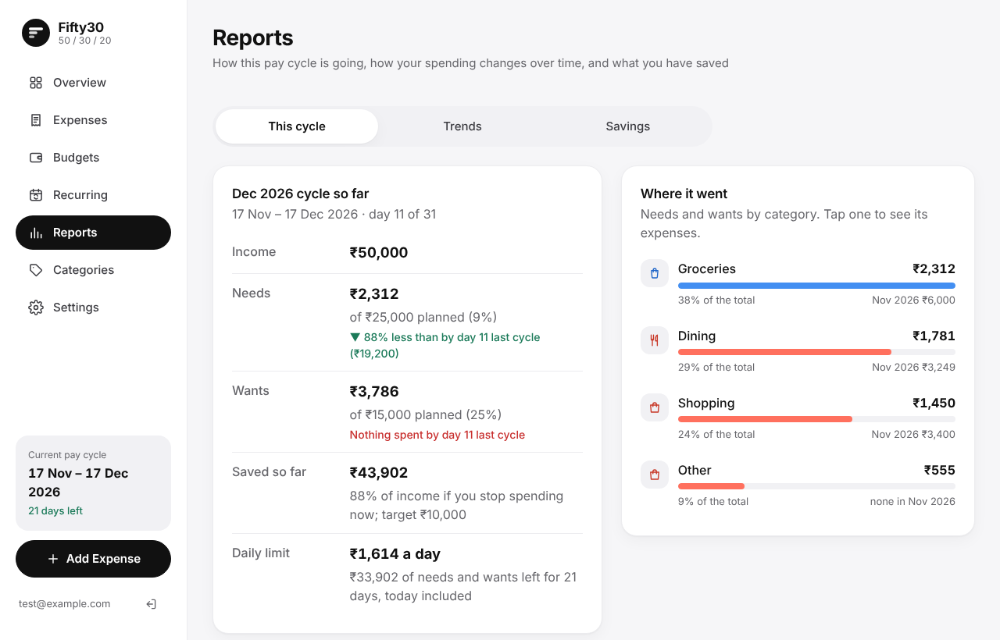
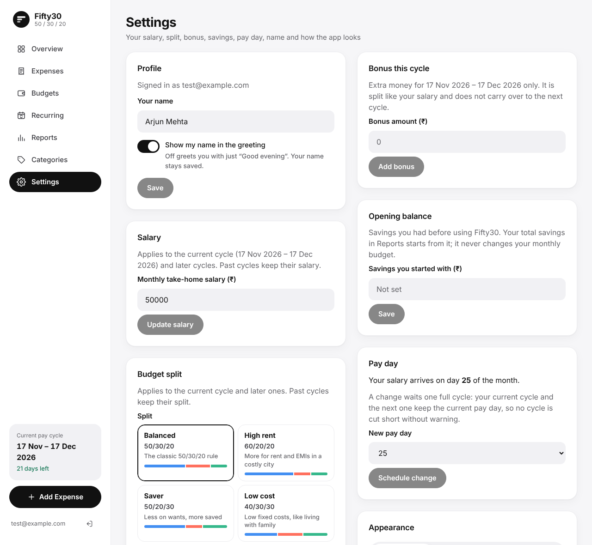
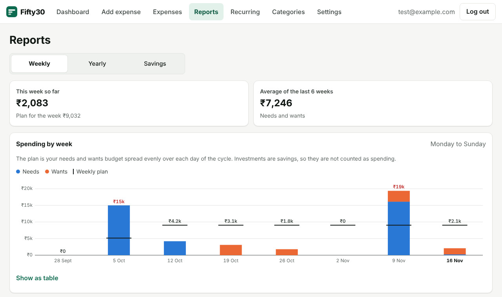
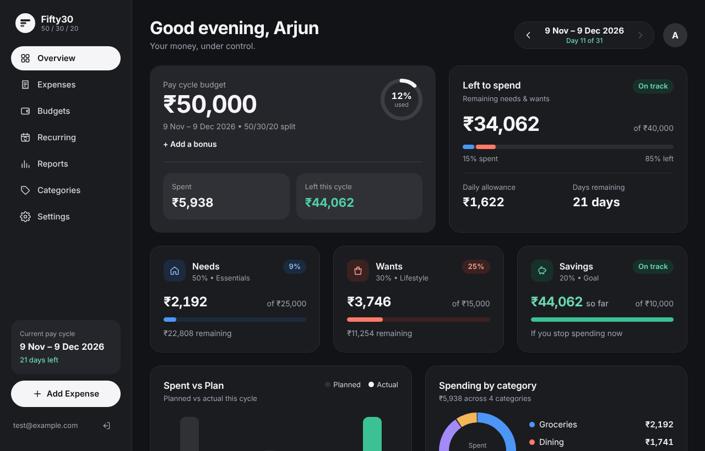

# Fifty30

[](https://github.com/Hemant-Mhalsekar/Fifty30-finance-tracker/actions/workflows/ci.yml)

**Live:** https://fifty30-finance-tracker.vercel.app
**API docs:** https://fifty30-finance-tracker.vercel.app/api/docs (Swagger UI; log in through the page to try the endpoints)

A personal finance tracker for salaried people in India, named after the 50/30/20 budgeting rule. You enter your take-home salary and pay day; every pay cycle is split into **needs (50%)**, **wants (30%)** and **savings (20%)** (or one of three other presets), and each expense you log is measured against that plan. It runs in any browser and installs on a phone as an app.

Built as a portfolio project: a Java 25 / Spring Boot 4 API, a React + TypeScript frontend, and PostgreSQL on Supabase.



| Phone dashboard | Adding an expense | This cycle report |
| --- | --- | --- |
|  |  |  |

| Expenses | Budget details |
| --- | --- |
|  |  |

| Reports: this cycle so far | Settings: split presets, bonus, opening balance |
| --- | --- |
|  |  |

<details>
<summary>Trends: weekly report</summary>



</details>

<details>
<summary>Dark mode</summary>



</details>

_Screenshots use sample data._

## Features

- **Pay cycles, not calendar months.** A cycle runs from one pay day to the day before the next (the 29th–31st fall back to the last day of shorter months). Changing your pay day waits one full cycle, so no cycle is cut short without warning.
- **A split plan per cycle.** 50/30/20 by default, or one of three presets (High rent 60/20/20, Saver 50/20/30, Low cost 40/30/30). "Left to spend" on needs and wants, a daily allowance, overspending and deficit warnings, and budget alerts when needs or wants reach 80% and 100% of the plan (on the dashboard, and right after the expense that crossed the line).
- **Bonus and opening balance.** Add a bonus to the current cycle and it is split like salary. Savings you already had can be added once, and count toward total savings.
- **Fast expense entry on a phone.** Big amount field, category chips (with icons) ordered by recent use, Today/Yesterday buttons, a note of which bucket the expense counts toward, and "Log again" chips for things you buy often (one tap logs it for today, with Undo).
- **Expense list.** Search by description, filter by type, dates and category, daily totals that stay right across pages, and the time each expense was logged.
- **Budget details.** Each bucket for any cycle, broken down by category, with a warning when the previous cycle went over.
- **Push notifications** (Android and desktop browsers; iPhone once the app is on the Home Screen). A recurring payment on the morning it is due, an evening nudge only on days nothing was logged, an alert when needs or wants cross 80% or 100% of the plan, the new cycle on pay day and a Sunday summary of the week. Each kind can be switched off in Settings, and logging out stops them on that phone.
- **Works offline.** Expenses added without a connection wait on the phone and are sent when it comes back, never twice.
- **Recurring expenses.** Weekly (a maid on Saturdays), monthly (rent, SIPs, EMIs) or yearly (insurance, a domain) come due on their day; one tap adds them (with the amount actually paid) or skips that one.
- **"Did your salary change?"** asked once at the start of each new cycle.
- **Charts.** Spent vs plan, spending by category, spending over the cycle against an even pace, and past cycles (on the Budgets page).
- **Reports in three tabs.** This cycle: a statement of income, needs, wants, saved so far and the daily limit, each compared with the same day of the last cycle, plus "where it went" by category (tap one to see its expenses). Trends: weekly (against a plan prorated per day), per pay cycle, by category across cycles, and yearly, each with a table view. Savings: saved per finished cycle and in total. Year in review: income, spending, savings rate, best and toughest cycle and the top categories of any calendar year. Short highlights sum it up in plain sentences ("You saved 24% of your income in Oct 2026, your best in the last 4 cycles"), and the savings rate is shown next to every saved amount.
- **Built for the phone.** Pages you just visited open instantly, pull down to refresh, filters and editing open in bottom sheets, and the dashboard leads with what you can spend today (charts sit under "More details").
- **Documented API.** Swagger UI lists every endpoint with its real status codes and the exact error messages it can return; a test fails if an endpoint is added without them.
- **CSV export.** Download the filtered expense list for a spreadsheet; cells that would run as formulas are neutralised.
- **Installable PWA** with an offline shell, light/dark/system theme, and keyboard and screen-reader support for every chart (each also has a table view or a text legend).
- **Personal greeting.** Your name is asked when you sign up and used in the greeting; Settings can hide it (it stays saved) or change it.
- **Accounts.** Name, email and password, password reset by email, short-lived access tokens with rotating refresh tokens, and account deletion (password required, data removed after a 7-day grace period that a login cancels).

## Tech stack

| Part | Choices |
| --- | --- |
| Backend | Java 25, Spring Boot 4.1 (Web MVC, Data JPA, Security, OAuth2 resource server for JWT), Hibernate 7, Flyway, Bucket4j, Sentry, springdoc-openapi |
| Database | PostgreSQL 17 on Supabase (row-level security on, accessed only through the API) |
| Frontend | React 19, TypeScript, Vite, React Router, plain CSS (no UI library), hand-drawn SVG charts and icons, Inter (self-hosted) |
| Tests | JUnit 5, Mockito, Testcontainers (real PostgreSQL), Vitest, Playwright |
| Hosting | Render (API, Docker, Singapore, next to the Mumbai database), Vercel (frontend, also proxies `/api` so the browser sees one origin), GitHub Actions CI |

## Architecture

- **One origin for the browser.** Vercel serves the React app and forwards `/api/*` to the Spring Boot API on Render, so the refresh-token cookie can be `HttpOnly`, `SameSite=Strict` and scoped to `/api/auth`, with no CORS setup.
- **Backend in feature packages** (`auth`, `cycle`, `expense`, `recurring`, `report`, `settings`, …). Controllers only map HTTP and read the user id from the JWT; services hold the rules and the transactions; repositories are user-scoped queries. Errors leave through one handler as `{"error", "message"}`.
- **The pay cycle is the core entity.** A cycle stores its own salary, bonus, split percentages and the three allocations, so changing a salary, split or pay day never rewrites history. Missing cycles are created on demand when a request needs today's cycle, because the free server sleeps and cannot rely on a nightly job.
- **Thin reports API, logic in tested client code.** The API returns raw totals per cycle or per day from `GROUP BY` queries; grouping into weeks, months and years, prorating weekly plans and running savings totals happen in `reports.ts`, which has unit tests.
- **Schema owned by Flyway.** Every change is a new migration; Hibernate only validates. Database `CHECK` constraints repeat the key rules (allocations add up to income, amounts in range), so a bug in Java cannot store an impossible budget.
- **Offline-first expense entry.** The frontend queues expenses in local storage with a client id when there is no connection and sends them later; the API treats a repeated client id as the same expense.
- **Testing in layers.** Unit tests for the calculations, integration tests against real PostgreSQL in Docker for SQL, locking and security rules, and Playwright tests that drive the real UI against a small mock API.

## Engineering notes

The parts I would point a reviewer to:

- **Money is never a float.** Amounts are whole paise in `BIGINT` columns and JSON integers. The UI parses typed rupees as text; fractional JSON numbers are rejected with a 400.
- **Stored cycles beat the formula.** Cycles are created lazily ("roll-forward") under a `SELECT … FOR UPDATE` lock on the user with `INSERT … ON CONFLICT DO NOTHING`, so concurrent requests cannot create overlapping cycles. Past cycles keep their salary and pay day forever.
- **Races are handled in SQL.** Refresh-token rotation is one conditional `UPDATE`; presenting a used refresh token again revokes every session of that user (reuse detection), except one retry within two minutes, so a reply lost on a weak mobile network or two tabs refreshing together do not log anyone out. The app only treats a clear refusal as "logged out"; a network error keeps the user signed in. Confirming a recurring expense locks its row and checks the due date the user was looking at, so two taps or two devices add it once.
- **Idempotent offline sync.** Each expense saved offline carries a client-generated UUID; a partial unique index on `(user_id, client_id)` makes retries safe.
- **Reports come from `GROUP BY` queries**, never from loading expenses into memory. Expenses are matched to cycles by date range in one JPQL join.
- **Every query is scoped to the user.** Repositories extend Spring Data's bare `Repository`, so there is no `findById` without a user id; another user's data always answers 404.
- **Privacy-minded logging and monitoring.** No request bodies, tokens, emails or SQL parameters in logs. Sentry is off unless configured, sends no personal data, strips reset tokens from URLs, and is loaded on demand in the browser.
- **Totals that stay right across pages.** The expense list returns the total for every match and per-day totals counted over all matches, so a day split across two pages still shows its real total. Search, type and date filters share one JPQL fragment with the CSV export.
- **Web Push without a push library.** Message encryption (RFC 8291: ECDH on P-256, HKDF, AES-128-GCM) and the VAPID signature (RFC 8292, ES256) are written on the JDK alone and checked against the RFC's own worked example. The server only posts to known push services (no SSRF through a crafted endpoint), and every reminder first claims a row in a send log (`INSERT … ON CONFLICT DO NOTHING`), so restarts, redeploys and a sleeping free server never send the same reminder twice.
- **Instant page switches without stale data.** GET answers are kept in memory for two minutes and shared between components asking at once; any change (POST/PUT/DELETE) or a new access token clears them, so edits show at once and one person's data never shows for the next. Nothing is written to browser storage.
- **Accessibility.** 44 px touch targets and 16 px inputs (both checked by a browser test), all text at 4.5:1 contrast in both themes, colour never the only signal in charts (every chart prints its values).

## Project layout

```
backend/    Spring Boot API (feature packages: auth, cycle, expense, recurring, report, …)
frontend/   React app (pages, components, charts, offline queue, PWA files)
docs/       Screenshots
.github/    CI workflow
```

## Running it locally

You need JDK 25, Node 24 and Docker (for the backend tests).

```bash
# Backend: needs a PostgreSQL connection and a JWT secret, see backend/README.md
cd backend
set -a; source .env; set +a
./mvnw spring-boot:run

# Frontend: proxies /api to localhost:8080
cd frontend
npm install
npm run dev
```

Details, environment variables and the API overview: [backend/README.md](backend/README.md) and [frontend/README.md](frontend/README.md).

## Tests

Every pull request runs everything in GitHub Actions ([ci.yml](.github/workflows/ci.yml)):

- **Backend:** unit tests and integration tests against a real PostgreSQL 17 in Docker (Testcontainers), covering auth and token rotation, roll-forward races, reports, recurring expenses, offline retries and row-level security on every table.
  ```bash
  cd backend && ./mvnw test
  ```
- **Frontend:** lint, type check, build, unit tests (Vitest) and browser tests (Playwright, phone-sized) against an in-memory mock API.
  ```bash
  cd frontend && npm test && npm run test:e2e
  ```

Deploys happen on every push to `main` and do not run tests, so pull requests are merged only when CI is green.

## Deployment

| Where | What | Settings |
| --- | --- | --- |
| Render (free web service, Docker) | `backend/` | `DB_URL`, `DB_USER`, `DB_PASSWORD`, `JWT_SECRET`, `APP_BASE_URL`; optional `BREVO_API_KEY` + `MAIL_FROM_ADDRESS` (reset emails), `VAPID_PUBLIC_KEY` + `VAPID_PRIVATE_KEY` (push notifications), `SENTRY_DSN` |
| Vercel | `frontend/` | optional `VITE_SENTRY_DSN` |
| Supabase | PostgreSQL | connect through the session pooler; Flyway runs the migrations on start |

## Limitations

Known trade-offs, mostly from keeping it a free, single-person project:

- **Savings only know what you log.** There is no bank sync. Unspent money counts as saved, so early in a cycle "saved so far" is high and falls as you spend.
- **Four split presets, no custom percentages**, and one bonus amount per cycle (it does not repeat in later cycles).
- **"Monthly" means pay cycle.** The monthly report has one column per pay cycle, named after the month most of it falls in, not calendar months.
- **India only:** rupees, Indian number formatting, and dates in India time.
- **Recurring expenses are monthly** (on a day of the month); weekly or yearly ones are not supported.
- **Signing up with an email that is already used says so**, which reveals that the account exists.
- **Free hosting:** the Render server sleeps when idle, so the first visit after a quiet spell can take up to about three minutes while it wakes. Rate limits are kept in memory on that single server and reset when it restarts.
- **Offline expenses wait in the browser's storage** (amount, description, date) until they are sent; clearing site data before reconnecting loses them.
- **The theme choice is per device**, not saved to the account.
