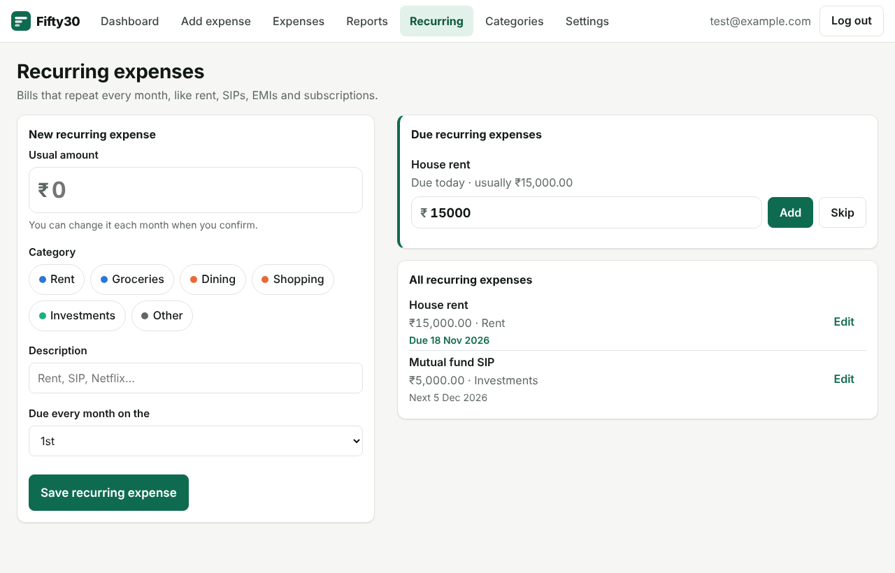

# Fifty30

[](https://github.com/Hemant-Mhalsekar/Fifty30-finance-tracker/actions/workflows/ci.yml)

**Live:** https://fifty30-finance-tracker.vercel.app

A personal finance tracker for salaried people in India, named after the 50/30/20 budgeting rule. You enter your take-home salary and pay day; every pay cycle is split into **needs (50%)**, **wants (30%)** and **savings (20%)**, and each expense you log is measured against that plan. It runs in any browser and installs on a phone as an app.

Built as a portfolio project: a Java 25 / Spring Boot 4 API, a React + TypeScript frontend, and PostgreSQL on Supabase.


| Phone dashboard | Adding an expense |
| --- | --- |
|  |  |

| Weekly report | Recurring expenses |
| --- | --- |
|  |  |

<details>
<summary>Dark mode</summary>


</details>

_Screenshots use sample data._

## Features

- **Pay cycles, not calendar months.** A cycle runs from one pay day to the day before the next (the 29th–31st fall back to the last day of shorter months). Changing your pay day waits one full cycle, so no cycle is cut short without warning.
- **50/30/20 plan per cycle.** "Left to spend" on needs and wants, a daily allowance, overspending and deficit warnings.
- **Fast expense entry on a phone.** Big amount field, category chips ordered by recent use, Today/Yesterday buttons.
- **Works offline.** Expenses added without a connection wait on the phone and are sent when it comes back, never twice.
- **Recurring expenses.** Rent, SIPs, EMIs and subscriptions come due on their day; one tap adds them (with the amount actually paid) or skips the month.
- **"Did your salary change?"** asked once at the start of each new cycle.
- **Charts.** Spent vs plan, spending by category, spending over the cycle against an even pace, and past cycles.
- **Reports.** Weekly (against a plan prorated per day), yearly, and savings over time.
- **Installable PWA** with an offline shell, light/dark/system theme, and keyboard and screen-reader support for every chart (each also has a table view).
- **Accounts.** Email and password, password reset by email, short-lived access tokens with rotating refresh tokens, and account deletion (password required, data removed after a 7-day grace period that a login cancels).

## Tech stack

| Part | Choices |
| --- | --- |
| Backend | Java 25, Spring Boot 4.1 (Web MVC, Data JPA, Security, OAuth2 resource server for JWT), Hibernate 7, Flyway, Bucket4j, Sentry |
| Database | PostgreSQL 17 on Supabase (row-level security on, accessed only through the API) |
| Frontend | React 19, TypeScript, Vite, React Router, plain CSS (no UI library), hand-drawn SVG charts |
| Tests | JUnit 5, Mockito, Testcontainers (real PostgreSQL), Vitest, Playwright |
| Hosting | Render (API, Docker), Vercel (frontend, also proxies `/api` so the browser sees one origin), GitHub Actions CI |

## Engineering notes

The parts I would point a reviewer to:

- **Money is never a float.** Amounts are whole paise in `BIGINT` columns and JSON integers. The UI parses typed rupees as text; fractional JSON numbers are rejected with a 400.
- **Stored cycles beat the formula.** Cycles are created lazily ("roll-forward") under a `SELECT … FOR UPDATE` lock on the user with `INSERT … ON CONFLICT DO NOTHING`, so concurrent requests cannot create overlapping cycles. Past cycles keep their salary and pay day forever.
- **Races are handled in SQL.** Refresh-token rotation is one conditional `UPDATE`; presenting a used refresh token again revokes every session of that user (reuse detection). Confirming a recurring expense locks its row and checks the due date the user was looking at, so two taps or two devices add it once.
- **Idempotent offline sync.** Each expense saved offline carries a client-generated UUID; a partial unique index on `(user_id, client_id)` makes retries safe.
- **Reports come from `GROUP BY` queries**, never from loading expenses into memory. Expenses are matched to cycles by date range in one JPQL join.
- **Every query is scoped to the user.** Repositories extend Spring Data's bare `Repository`, so there is no `findById` without a user id; another user's data always answers 404.
- **Privacy-minded logging and monitoring.** No request bodies, tokens, emails or SQL parameters in logs. Sentry is off unless configured, sends no personal data, strips reset tokens from URLs, and is loaded on demand in the browser.
- **Accessibility.** 44 px touch targets and 16 px inputs (both checked by a browser test), all text at 4.5:1 contrast in both themes, colour never the only signal in charts.

## Project layout

```
backend/    Spring Boot API (feature packages: auth, cycle, expense, recurring, report, …)
frontend/   React app (pages, components, charts, offline queue, PWA files)
docs/       Screenshots
.github/    CI workflow
```

## Running it locally

You need JDK 25, Node 24 and Docker (for the backend tests).

```bash
# Backend: needs a PostgreSQL connection and a JWT secret, see backend/README.md
cd backend
set -a; source .env; set +a
./mvnw spring-boot:run

# Frontend: proxies /api to localhost:8080
cd frontend
npm install
npm run dev
```

Details, environment variables and the API overview: [backend/README.md](backend/README.md) and [frontend/README.md](frontend/README.md).

## Tests

Every pull request runs everything in GitHub Actions ([ci.yml](.github/workflows/ci.yml)):

- **Backend:** unit tests and integration tests against a real PostgreSQL 17 in Docker (Testcontainers), covering auth and token rotation, roll-forward races, reports, recurring expenses, offline retries and row-level security on every table.
  ```bash
  cd backend && ./mvnw test
  ```
- **Frontend:** lint, type check, build, unit tests (Vitest) and browser tests (Playwright, phone-sized) against an in-memory mock API.
  ```bash
  cd frontend && npm test && npm run test:e2e
  ```

Deploys happen on every push to `main` and do not run tests, so pull requests are merged only when CI is green.

## Deployment

| Where | What | Settings |
| --- | --- | --- |
| Render (free web service, Docker) | `backend/` | `DB_URL`, `DB_USER`, `DB_PASSWORD`, `JWT_SECRET`, `APP_BASE_URL`; optional `BREVO_API_KEY` + `MAIL_FROM_ADDRESS` (reset emails), `SENTRY_DSN` |
| Vercel | `frontend/` | optional `VITE_SENTRY_DSN` |
| Supabase | PostgreSQL | connect through the session pooler; Flyway runs the migrations on start |

## Limitations

- Savings only know about what you log: there is no opening balance, bank sync or bonus income.
- India only: rupees, Indian number formatting, and dates in IST.
- The 50/30/20 split is fixed for now.
- Registering with an email that is already used says so, which reveals that the account exists.
- The free Render instance sleeps when idle, so the first visit can take up to about three minutes while it wakes.
